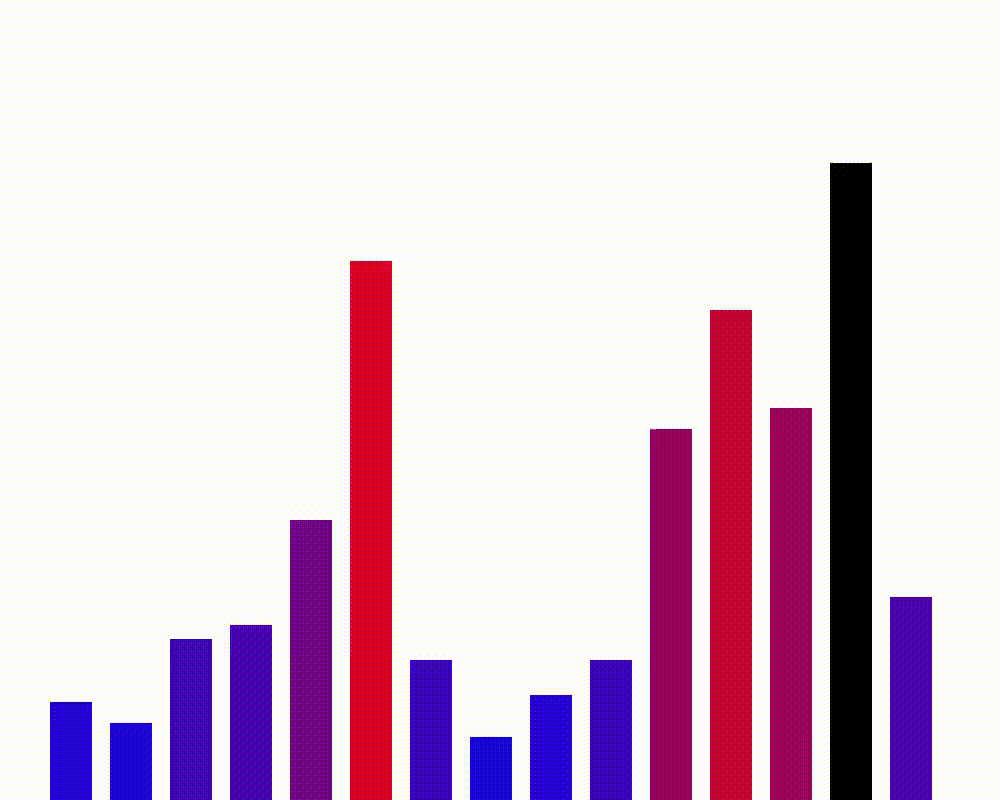

# Algorithms and Data Structures

## Motivation

I have fragmented knowledge of this topic, which I have developed through sporadic reading, watching videos, studying mathematics (some of which is related), and practice. Through this project, I hope to learn the fundamentals of DSA (roughly the content of an undergraduate course) in a structured way.

I also want to practice C++, so I'll use both C and C++. In the C implementation, my main goal will be to master data structures and algorithms, while in C++, I'll focus on implementing the algorithms and making the most of the language's features.
I've decided to include C# and Python as well. With C#, I'll try to master an allocation free approach (and the idiomatic too) and with Python the goal will be simply get familiar with the language.

The gif below was made, almost entirely, by myself using an idea that I saw in one video of Tsoding, where he creates .ppm images from scratch and pipes them to ffmpeg to make a video. 
I use the knowledge that he presented in that video to create a mini graphics lib that draws to a buffer and then creates the .ppm from it. The part that I didn't make was transforming the sequence of images into a gif, this was made by the ffmpeg.

